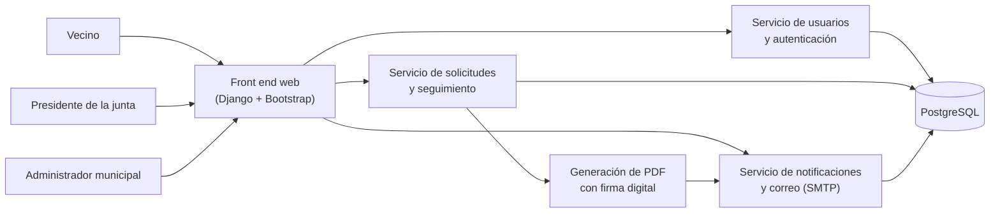

# Portal Vecinal.cl

Plataforma web multiservicios para modernizar la gestión de las juntas de vecinos: los vecinos solicitan documentos y espacios comunes en línea, reciben sus certificados en PDF por correo y siguen cada trámite con un código de seguimiento. Se comercializa a las municipalidades como servicio (SaaS B2G).

Proyecto APT · Ingeniería Informática, Duoc UC.

## Descripción

**Qué hace.** El vecino ingresa con su RUN y correo, y el sistema lo asigna automáticamente a su junta de vecinos según su domicilio. Desde ahí puede:

- **Solicitar documentos** (certificados de residencia, afiliación y antigüedad). El sistema los genera como PDF con la firma digital del presidente de la junta y los envía al correo del vecino.
- **Solicitar espacios comunes** (sede, multicancha, plaza). El presidente de la junta revisa la solicitud y la aprueba o rechaza.
- **Hacer seguimiento** de cada solicitud (`SEG-xxxx`) y recibir notificaciones cuando hay novedades.

**A quién va dirigido.**

| Usuario | Qué hace en el portal |
|---------|-----------------------|
| Vecino | Solicita documentos y espacios comunes, y sigue sus trámites |
| Presidente de la junta | Revisa y resuelve las solicitudes de espacios comunes; sus certificados se emiten con su firma digital |
| Administrador municipal | Gestiona juntas de vecinos y usuarios, y supervisa el servicio de su comuna |

**Qué problema resuelve.** Las juntas de vecinos operan de forma manual y burocrática: el vecino debe ir presencialmente a pedir un certificado, no sabe en qué estado está su solicitud, y el presidente gestiona todo en papel o por mensajes informales. Esto afecta especialmente a los adultos mayores, que son el 58,8% de la población del caso de estudio y enfrentan barreras de accesibilidad. El portal digitaliza el proceso completo, elimina desplazamientos y deja trazabilidad de cada trámite.

**Caso de estudio.** Junta de Vecinos Villa San Joaquín, con más de 800 hogares inscritos. La solución está pensada para las Unidades Territoriales de las 350 comunas del país.

### Flujo de las solicitudes (modelo TO-BE)

Toda solicitud queda registrada y genera un código de seguimiento.

| Tipo de solicitud | Quién interviene | Resultado |
|-------------------|------------------|-----------|
| Documento | El sistema: actualiza el seguimiento, prepara el PDF con la firma digital del presidente y lo envía | Notificación al vecino y PDF en su correo, descargable desde el portal |
| Espacio común | El presidente de la junta revisa y aprueba o rechaza | Notificación al vecino con la decisión y un comentario opcional |

## Tecnologías utilizadas

| Capa | Tecnología |
|------|------------|
| Lenguaje | Python 3 |
| Framework web | Django 5 |
| Interfaz | HTML5, plantillas Django, Bootstrap 5.3 y Bootstrap Icons |
| Base de datos | PostgreSQL |
| Correo | SMTP, para el envío de documentos y notificaciones |
| Documentos | Generación de PDF con firma digital |
| Diseño | Mockups en Figma; procesos en Bizagi Modeler (BPMN) |
| Infraestructura | Servidor local |
| Metodología | Scrum |

## Cómo ejecutar el proyecto localmente

Requisitos: Python 3.10 o superior, pip y PostgreSQL.

```bash
# 1. Entrar a la carpeta del proyecto
cd juntavecinal

# 2. Crear y activar un entorno virtual
python -m venv venv
source venv/bin/activate        # En Windows: venv\Scripts\activate

# 3. Instalar dependencias
pip install -r requirements.txt
```

**Variables de entorno** (base de datos y correo):

```bash
export DJANGO_SECRET_KEY="una-clave-larga-y-secreta"
export DB_NAME=portal_vecinal DB_USER=postgres DB_PASSWORD=tu_clave DB_HOST=localhost DB_PORT=5432
export EMAIL_HOST=smtp.tu-servidor.cl EMAIL_PORT=587 EMAIL_HOST_USER=usuario EMAIL_HOST_PASSWORD=clave
```

```bash
# 4. Crear la base de datos y aplicar las migraciones
createdb portal_vecinal
python manage.py migrate

# 5. Levantar el servidor
python manage.py runserver
```

Abrir http://127.0.0.1:8000 en el navegador.

### Modo demostración (solo front end)

Si solo quieres ver la interfaz, no necesitas base de datos ni variables de entorno: instala las dependencias y ejecuta `python manage.py runserver`. En este modo el portal usa datos de ejemplo definidos en `portal/mock_data.py`.

### Cuentas de demostración

| Rol | RUN | Correo |
|-----|-----|--------|
| Vecino | 18.765.432-7 | vecino@correo.cl |
| Presidente de la junta | 12.345.678-5 | presidente@jv.cl |
| Administrador | 11.111.111-1 | admin@municipio.cl |

## Integrantes del equipo

| Integrante | Rol |
|------------|-----|
| Felipe Guajardo | Desarrollo Frontend / Diseño UI-UX |
| Miguel Montero | Desarrollo Backend y Base de Datos |

Estudiantes de Ingeniería Informática, Duoc UC.

## Metodología de trabajo

El equipo trabajó con **Scrum**, dividiendo el trabajo en sprints cortos. La metodología permitió adaptar la propuesta original a un MVP funcional frente a las restricciones de tiempo y los ajustes de arquitectura, y reestructurar la carta Gantt para nivelar el avance entre código y documentación.

Fases ejecutadas:

1. **Levantamiento y diseño:** requerimientos con una junta de vecinos real, procesos As-Is y To-Be (BPMN), modelo entidad-relación y mockups en Figma.
2. **Desarrollo:** modelos en Django, autenticación por RUN y correo, asignación automática de junta, generación de PDF con firma digital y maquetación web responsiva.
3. **Integración y pruebas:** conexión con PostgreSQL, configuración del servicio SMTP y pruebas funcionales con usuarios.

## Arquitectura de la solución

Arquitectura **multiservicios**: un front end web que se comunica con servicios independientes, todos sobre una base de datos PostgreSQL, desplegados en servidor local.



### Modelo de datos

Tablas principales: `USUARIO`, `HOGAR`, `JUNTA_VECINAL`, `SOLICITUD`, `TIPO_DOCUMENTO` y `DOCUMENTO`, relacionadas mediante llaves primarias y foráneas. El domicilio del hogar determina la junta de vecinos asignada al usuario.

### Estructura del repositorio

```
config/              Configuración de Django
portal/views.py      Vistas, con control de acceso por rol
portal/mock_data.py  Datos de ejemplo para el modo demostración
templates/           Plantillas por rol, con base.html compartido
static/css/app.css   Estilos del portal sobre Bootstrap
```
